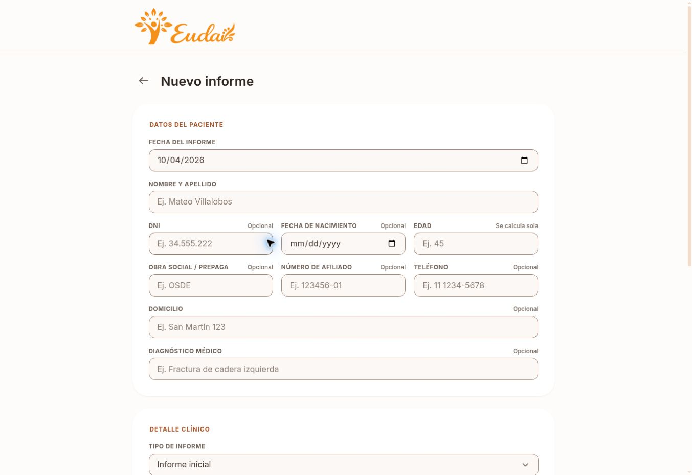

# Eudai Informes

Aplicación web para redactar informes profesionales, previsualizarlos en A4 y guardarlos como PDF mediante la impresión del navegador.

**[Abrir la aplicación](https://eudai-informes.netlify.app/#/)**

## Vista previa

| Formulario | Vista previa del documento |
| --- | --- |
|  |  |

La vista previa usa información ficticia. Este repositorio no incluye informes ni datos reales de pacientes.

## El problema

Preparar informes similares de forma repetida exige ordenar los datos del paciente y del profesional, mantener una presentación consistente y no equivocarse al transcribir. Y como se trata de información de salud, importa tanto el resultado como saber qué queda guardado y dónde.

## La solución

Una herramienta centrada en el flujo completo del informe: carga de datos, validación, redacción, vista previa paginada y descarga en PDF.

## Funcionalidades

- Formulario con campos del paciente, tipo de informe, especialidad, contenido y profesional responsable.
- Validación y saneamiento de los datos antes de componer el documento.
- Vista previa A4 paginada y descarga mediante la impresión del navegador.
- Borrador automático del informe en curso, para que cerrar la pestaña no se lleve el trabajo.

## Tecnologías

HTML, CSS y JavaScript nativo con módulos ES. No requiere dependencias ni compilación. El sitio se publica como contenido estático en Netlify.

## Cómo está organizado

| Ruta | Responsabilidad |
| --- | --- |
| `index.html`, `css/app.css` | Formulario e interfaz adaptable |
| `report-template.html`, `css/report.css` | Documento A4 y estilos de impresión |
| `js/schema.js`, `js/sanitize.js`, `js/validate.js` | Campos, saneamiento y validación |
| `js/store.js` | Borrador del informe en curso |
| `js/boot.js`, `js/report.js`, `js/app.js`, `js/ui.js`, `js/format.js` | Composición del informe y flujo de la interfaz |
| `_headers`, `netlify.toml` | Cabeceras y configuración del despliegue |

## Ejecutar en local

Desde la raíz del repositorio:

```bash
python3 -m http.server 8000
```

Abrí `http://localhost:8000/`. Los módulos y la plantilla necesitan servirse por HTTP; abrir `index.html` directamente no funciona.

## Alcance de esta versión

**El archivo del informe es el PDF**: se genera, se previsualiza, se descarga y se envía. La aplicación **no guarda los informes**.

Esa decisión es deliberada. Una versión anterior mantenía un historial en el navegador, pero el historial vive en el `localStorage` de cada equipo y no se comparte entre dispositivos: un informe hecho en el celular nunca aparecía en la computadora del consultorio. No servía como archivo y, mientras tanto, iba acumulando datos de salud en cada equipo donde se abrió la aplicación. Se quitó.

Lo único que se guarda es el **borrador en curso**: el formulario que se está escribiendo, para que un cierre accidental no se lleve el trabajo. Se sobrescribe permanentemente y se borra al descargar el PDF, así que nunca hay más de un informe a medio escribir almacenado.

Al abrir la aplicación se **borran los informes que hubieran quedado guardados por versiones anteriores**. Quitar la pantalla que los mostraba sin borrar los datos dejaría información de pacientes dormida en el navegador, invisible y fuera del alcance del usuario.

No hay backend: no existe una base de datos que pueda filtrarse, y nada sale del dispositivo. El control de acceso efectivo es el bloqueo del equipo.

## Decisiones técnicas

La validación y el saneamiento están separados de la interfaz. Los valores del informe se insertan en la plantilla como texto, y la paginación contempla contenido largo para evitar cortes en el PDF. Las cabeceras de Netlify incluyen una política de seguridad de contenido y los recursos se sirven desde el propio sitio.

Las correcciones, decisiones de implementación y limitaciones están en las [notas técnicas](docs/NOTAS_TECNICAS.md).

---

Desarrollado por [Jeremias Hilt Peletti](https://jeremiashiltpeletti.com/).
